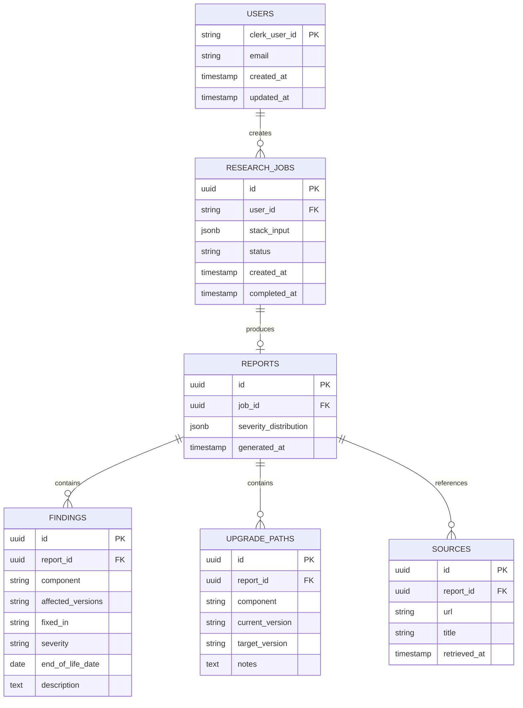

# Data Model Specification

This document details the database schema and entity relationships for Group 2: Tech Stack Issues Finder, adhering to Milestone 4.1.

## Entity Details

### 1. `users`
* `clerk_user_id` (VARCHAR(128), PRIMARY KEY): Unique identifier provided by Clerk auth.
* `email` (VARCHAR(255), NULLABLE): User contact email.
* `created_at` (TIMESTAMP): Creation timestamp.

### 2. `research_jobs`
* `id` (UUID, PRIMARY KEY): Unique job identifier.
* `user_id` (VARCHAR(128), FOREIGN KEY `users.clerk_user_id`): Job owner.
* `stack_input` (JSONB): Array of `[{ "name": "...", "version": "..." }]`.
* `status` (VARCHAR(32)): One of `queued`, `running`, `partial`, `failed`, `completed`.
* `created_at` (TIMESTAMP): Submission timestamp.
* `completed_at` (TIMESTAMP, NULLABLE): Finish timestamp.

### 3. `reports`
* `id` (UUID, PRIMARY KEY): Unique report identifier.
* `job_id` (UUID, FOREIGN KEY `research_jobs.id`): Associated job.
* `severity_distribution` (JSONB): Counts of `{ critical: N, high: N, medium: N, low: N, info: N }`.
* `generated_at` (TIMESTAMP): Generation timestamp.

### 4. `findings`
* `id` (UUID, PRIMARY KEY): Identifier (or CVE identifier).
* `report_id` (UUID, FOREIGN KEY `reports.id`): Associated report.
* `component` (VARCHAR(100)): Package/library name.
* `affected_versions` (VARCHAR(100)): Affected SemVer range.
* `fixed_in` (VARCHAR(100), NULLABLE): Fixed release version.
* `severity` (VARCHAR(20)): `critical`, `high`, `medium`, `low`, `info`.
* `end_of_life_date` (DATE, NULLABLE): EOL date if component version is deprecated.
* `description` (TEXT): Advisory summary.

### 5. `upgrade_paths`
* `id` (UUID, PRIMARY KEY): Identifier.
* `report_id` (UUID, FOREIGN KEY `reports.id`): Associated report.
* `component` (VARCHAR(100)): Library name.
* `current_version` (VARCHAR(50)): User's active version.
* `target_version` (VARCHAR(50)): Recommended safe version.
* `notes` (TEXT): Migration precautions / breaking change summary.

### 6. `sources`
* `id` (UUID, PRIMARY KEY): Source link identifier.
* `report_id` (UUID, FOREIGN KEY `reports.id`): Associated report.
* `url` (TEXT): Origin link discovered via SearXNG / Crawl4AI.
* `title` (VARCHAR(255)): Source title or advisory name.
